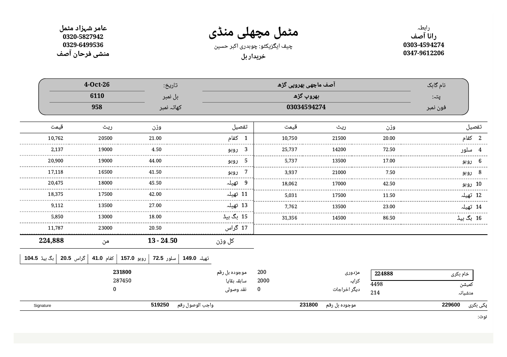
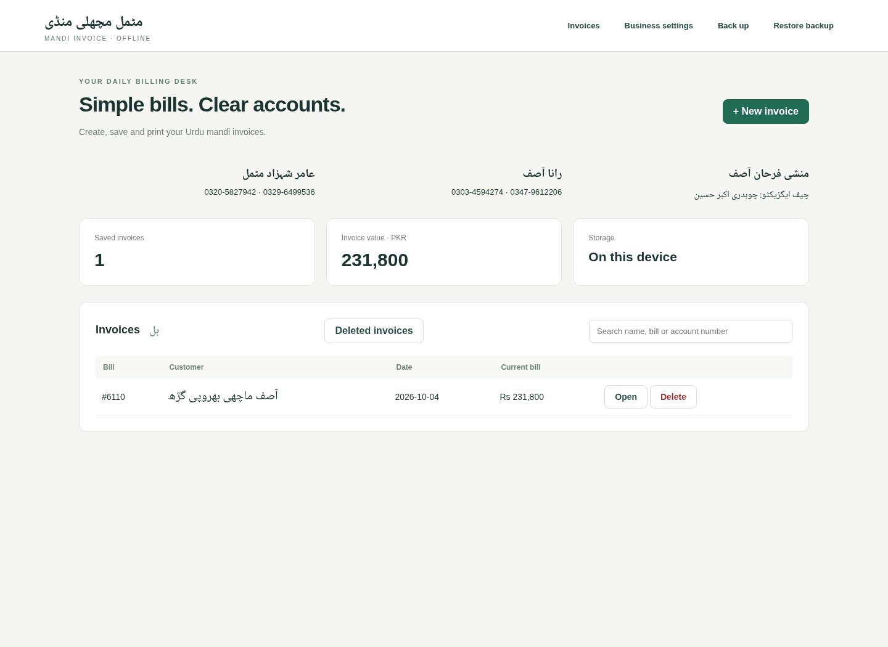
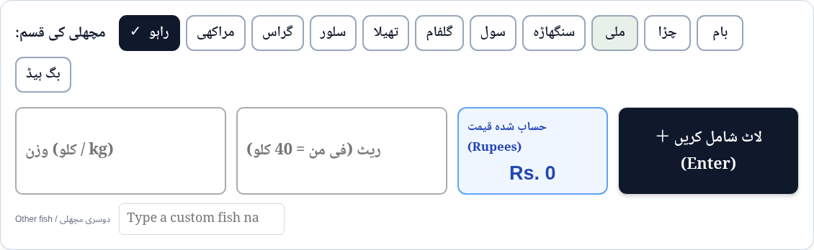
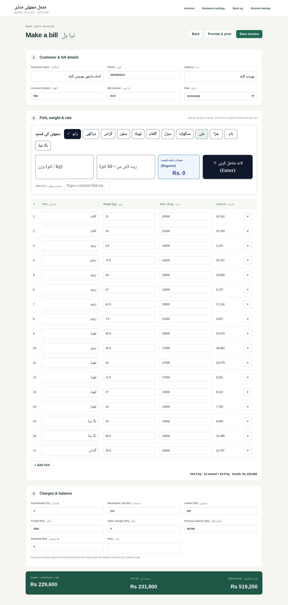
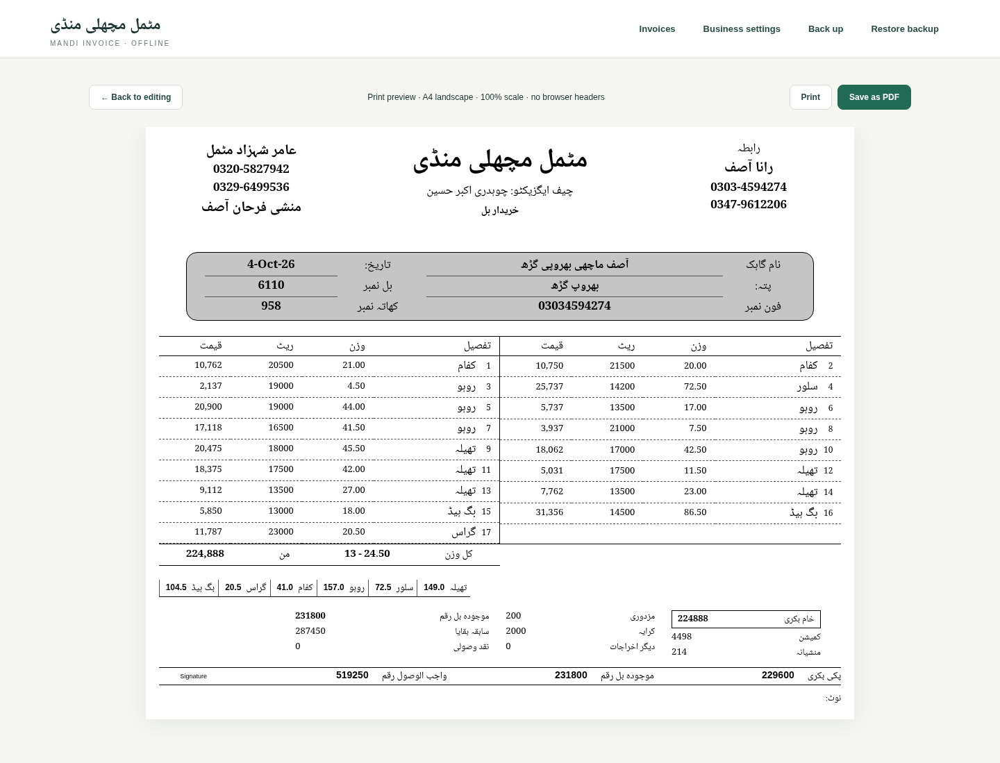
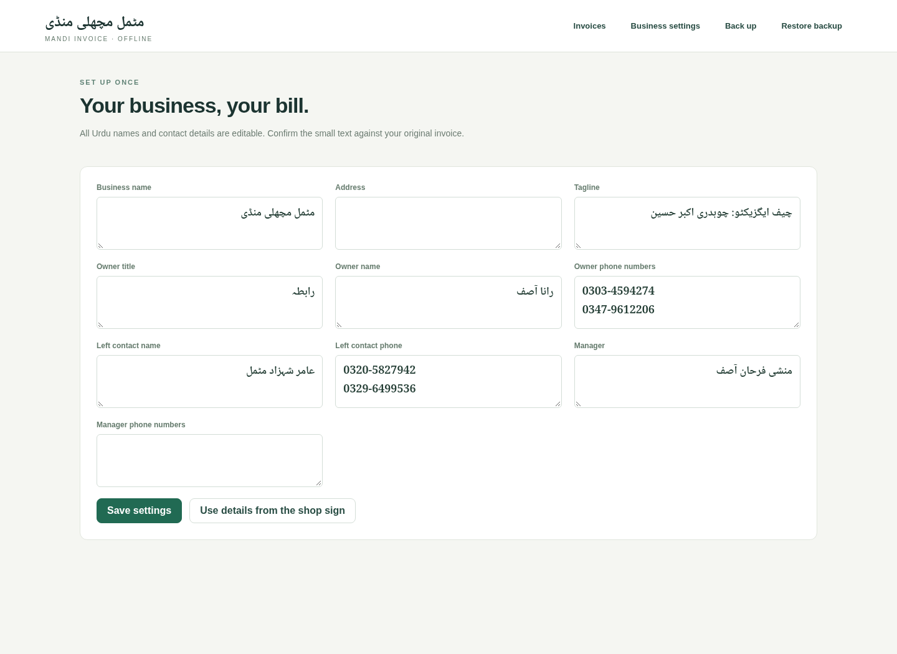
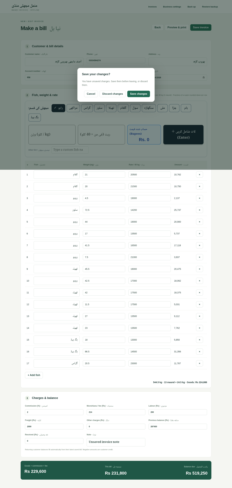
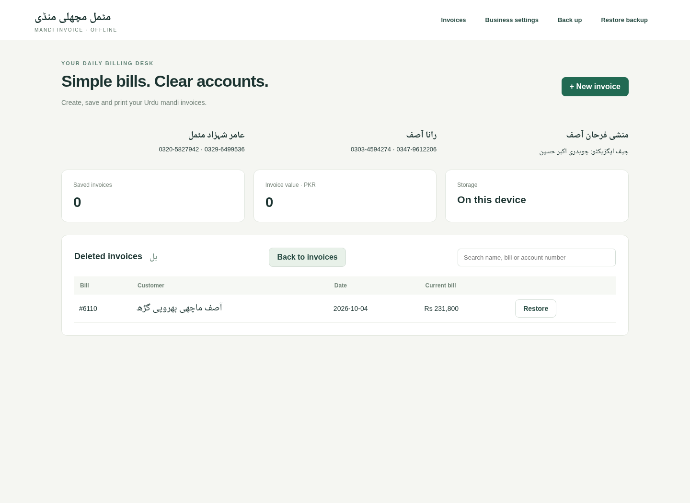

# Mandi Invoice

A focused, offline Urdu fish-market billing app for Intel Mac and Windows x64. Search/select a fish, enter the **negotiated rate for that row**, enter its weight, then save and print. No fixed fish prices, account signup, cloud service or subscription.

This is a new standalone MIT-licensed Electron app, not an Invoiso fork or an Invoiso database upgrade. Invoiso was inspected at commit `a7f9f6da9de149214142a4b2b6188efba85994e4`; no upstream application source was copied. Your existing Invoiso database remains separate. Importing it needs a version-specific migration, which is not implemented here.

[View the generated sample PDF](docs/sample-invoice.pdf)



## Shop identity

Current defaults use **مٹمل مچھلی منڈی** and the contacts/fish names from your shop sign. See [shop details and upgrade behavior](docs/SHOP-DETAILS.md). Rates are always entered per sale. The screenshots below show the updated shop details.

## Software screenshots

Captured from the running application in Chromium on Linux, using the approved sample invoice. The Electron desktop app uses the same interface; these images do not show native macOS or Windows window frames.

### Invoice list

Search saved bills by customer, bill number or account number.



### Invoice editor

Click a fish button, enter weight and the negotiated rate, then press Enter to add the lot. The live price uses the invoice’s rounding rules. Weight and rate clear for the next sale; existing rows remain editable.





### Print preview

Review the two-column Urdu invoice before printing or saving a PDF.



### Business settings

Edit the business name, Urdu address, owner and manager contact details.



To regenerate these screenshots from the repository root, run `node scripts/screenshots.mjs` after `npm ci`. This uses a fresh browser profile and does not modify your saved desktop invoices. Chromium must be installed; set `CHROMIUM_PATH` if it is not at `/usr/bin/chromium`.

### Unsaved changes and recovery





## Use it

1. Open the app and choose **Business settings**. Confirm the Urdu business name, address and contact numbers.
2. Choose **New invoice**, enter a customer, bill number and date. Previously saved customer names are searchable and fill their contact details.
3. Search/type each fish name. Enter kilograms and the rate agreed with this buyer **per 40 kg**. Add as many rows as needed. Repeated fish can have different prices.
4. Enter commission, fee, labour, freight, previous balance and payment. Select a returning customer to fetch their remaining balance automatically. New customers may have a manual opening balance.
5. **Save invoice**, then **Preview & print → Print or Save as PDF**. Use A4 landscape, 100% scale, no browser headers, and backgrounds enabled. Print opens the printer dialog. Save as PDF opens a file-save dialog directly and exports the full invoice.
6. Use **Back up** regularly. **Restore** validates a backup and asks before replacing data.

The app opens with your own invoice list; no demo action is shown. Saved bill numbers remain unique, including deleted invoices. A saved invoice captures its business header so later business changes do not rewrite it.

**Delete and restore:** Delete moves a bill to Deleted invoices after confirmation. Restore brings it back. A bill used for a later active customer's balance cannot be deleted until those dependent bills are deleted first. No permanent-delete option is provided.

**Unsaved changes:** Closing the desktop app or switching screens offers Save changes, Discard changes, and Cancel. Saving must succeed before closing; invalid or incomplete details keep the app open. Business settings use the same guard. Browser refresh/close uses the browser's built-in warning instead of the desktop dialog.


## Downloads and platform status

Download published installers from **[GitHub Releases](https://github.com/The-Rohan/invoice/releases)**. Choose the Intel Mac `.dmg` or Windows x64 `.exe` under the release's **Assets**. Source-code ZIP downloads do not contain the app.

A `v*` tag starts native Mac/Windows builds. The workflow tests both the source and packaged app, then publishes a preview release only if both platforms pass. If no release is listed yet, check [the build workflow](https://github.com/The-Rohan/invoice/actions/workflows/desktop.yml); a queued or failed build has no published installer.

These preview builds are unsigned. macOS may require the per-app Privacy & Security “Open Anyway” approval; Windows may show a publisher warning. No signing or notarization credentials have been provided. Do not disable OS protection globally.

Local cross-built portable archives are also available under `dist/`, but are not ordinary Git files. Their successful build does not establish native platform validation. See `docs/VALIDATION.md` for the local test record; GitHub Actions provides the results for each release.

## Development

Node.js 24, npm, and the host desktop environment are required for `npm start`.

```sh
npm ci
npm test
npm start
```

Browser integration tests on Linux use installed Chromium and Poppler's `pdfinfo`:

```sh
npm run test:ui
```

`CHROMIUM_PATH` can select another Chromium executable. Tests cover actual PDF page counts, not only HTML containers.

```sh
node test/desktop.mjs  # native Electron launch, file persistence, restart
npm run pack:mac      # Intel Mac ZIP; cross-build supported
npm run pack:win      # Windows x64 ZIP; cross-build supported
npm run dist:mac      # DMG, run on macOS
npm run dist:win      # NSIS installer, run on Windows
```

In the managed cloud environment retain its proxy and CA configuration. Electron downloads additionally need `ELECTRON_GET_USE_PROXY=1`, `GLOBAL_AGENT_HTTP_PROXY="$HTTP_PROXY"`, and `GLOBAL_AGENT_HTTPS_PROXY="$HTTPS_PROXY"`. TLS verification stays enabled.

## Data and limitations

Desktop data is an atomically replaced JSON file in Electron's OS-specific application data directory. The previous file is retained as `invoices.json.previous`. No telemetry or application network requests. Browser development mode uses localStorage instead and is separate from desktop data. Backups are portable JSON, contain customer details, and should be stored privately.

The layout follows the supplied screenshot, but it is not a certified pixel/letter-perfect reconstruction. The original small Urdu address/customer text is ambiguous at this resolution; see the transcription notes. Noto Naskh Arabic is bundled under the SIL Open Font License for offline text shaping. Original paper dimensions and font are unknown; A4 landscape is the tested default. Long text, unusually large values and physical printer margins need review before production use.

Customer balances carry forward through linked bills. Standalone payments, stock control, tax compliance, Invoiso import, cloud sync and multi-user concurrency are not implemented. Charges are explicit inputs; no unconfirmed business rule is silently inferred for the Rs 214 fee.

Full analysis, transcription, arithmetic and user journey: [docs/INVOICE-PLAN.md](docs/INVOICE-PLAN.md).

## Returning customer balances

Choose the customer from the suggestions (account/phone distinguishes identical names). The most recently created saved bill supplies their remaining بقایا, including payments recorded on invoices. The carried amount is read-only; new customers may enter an opening balance. Negative balances are customer credit.

New bills link to the preceding bill rather than summing accumulated totals. Reopening or editing a bill does not add its own balance again. Corrections to a linked earlier bill recalculate the later balance when opened or printed. Previously exported PDFs are unchanged. For records created before 1.0.4, the latest bill's recorded balance is the starting point; verify that historical opening amount once. Standalone payments outside invoices are not yet supported.
